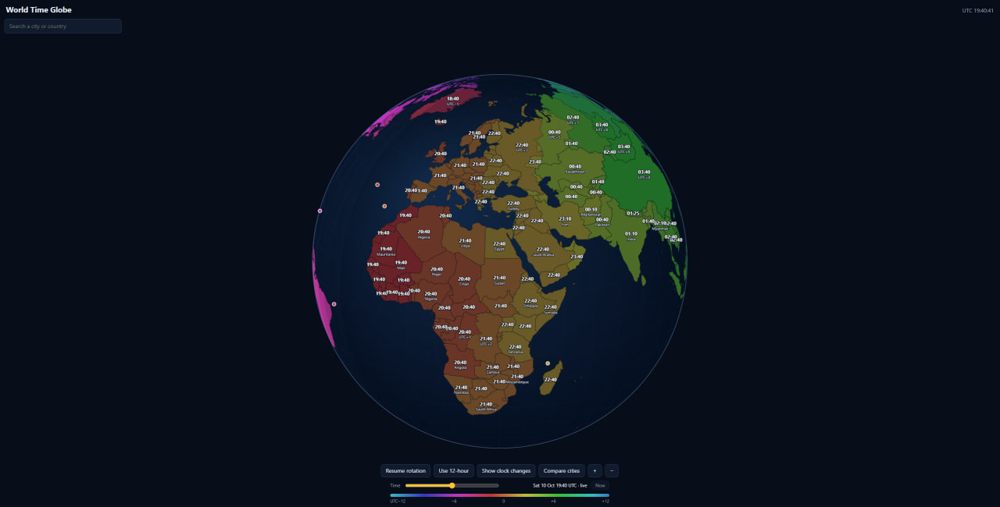

# World Time Globe

An interactive 3D globe that shows the current time in every country and time zone. Drag to rotate, zoom in to see
zone borders inside big countries, and scrub a slider to see what the world looks like up to 24 hours from now.



## Features

- **Live clocks** on a rotating globe, with every zone coloured by its UTC offset (UTC−12 … +12) and a legend.
- **Hover tooltips** with the local time, UTC offset and zone names, including a note on daylight saving time.
- **Zones inside countries.** Countries that span several zones (US, Russia, Brazil, Australia, …) are split into
  their real zone regions, and the map gets finer detail as you zoom in.
- **Search** for a city or country and fly straight to it.
- **Clock changes.** Highlights the countries that change their clocks this month and lists them.
- **Compare cities.** Pick two cities and see the time difference between them.
- **Time slider.** Move ±24 h from now; clocks, zones, DST and search all follow it. *Now* snaps back to live time.
- **Day and night** with civil, nautical and astronomical twilight and a sun marker.
- **Sunrise, sunset and day length** for a city, in its search card and in Compare, for the day the time slider is on,
  with how much longer or shorter the day is than yesterday (and polar day / night near the poles).
- **Legend focus.** Point at an hour on the colour legend (or tap it) and only the zones with that UTC offset keep their
  colour; click to keep the choice, click again or press Esc to clear it.
- **12 / 24-hour** display, pause/resume rotation, zoom buttons and touch support.
- **Light and dark themes**, including a light-blue globe with pastel zones. Follows your system setting until you click
  the sun/moon button in the top right corner; it then remembers your choice.
- A plain message is shown when JavaScript is turned off.

## For developers

Running it locally, rebuilding the data and the project layout are folded away below.

<details>
<summary><b>How to run it</b></summary>

The site is static (vanilla JavaScript and [d3](https://d3js.org), no build step), but it uses ES modules, so it has to be
served over HTTP; opening `index.html` from disk will not work.

```sh
# quickest
python3 -m http.server 8000 --directory site      # http://localhost:8000

# or with nginx in Docker (gzip + long-lived caching for the data files)
docker compose up -d                              # http://localhost:8080
```

</details>

<details>
<summary><b>Project layout</b></summary>

| Path | What it is |
| --- | --- |
| `site/` | The web page: `index.html`, `style.css`, `js/` (one module per feature) and the data files |
| `site/countries.js`, `site/cities.<hash>.json`, `site/detail-N.<hash>.json` | Generated data. The hash in the name lets nginx cache them for a year |
| `tools/` | Python scripts that generate that data |
| `nginx/default.conf` | nginx config used by `docker-compose.yml` (gzip, cache headers) |

</details>

<details>
<summary><b>Rebuilding the data</b></summary>

The generated files are committed, so you only need this to update the map or the city list.

```sh
pip install timezonefinder "shapely>=2.1" tzdata geonamescache

python3 tools/build_zones.py             # per-zone geometry -> site/countries.js
python3 tools/build_zones.py --detail    # zoomed-in outlines -> site/detail-1/2.<hash>.json
python3 tools/build_cities.py            # city search list   -> site/cities.<hash>.json
```

Add `--check` to `build_zones.py` to report without writing. Per-country tweaks live in `tools/zone_settings.json`.
Each script's docstring explains its inputs and output format.

</details>

<details>
<summary><b>Development</b></summary>

```sh
pip install ruff
ruff format tools            # format the Python tools (settings in pyproject.toml)
ruff format --check tools    # check only

node --test tests/*.test.mjs  # daylight-saving logic in site/js/tz.js (Node 18 or newer)
python3 -m unittest discover tests  # borders in the zoomed-in data stay shared (about 30 s, needs shapely)
```

`.editorconfig` covers the basics (UTF-8, LF, final newline) for any editor that supports it.

</details>

## Data and credits

- Country outlines: [Natural Earth](https://www.naturalearthdata.com/) (public domain).
- Time zone rules and history: the IANA time zone database, via Python's `tzdata`. Zone boundaries come from
  [timezonefinder](https://github.com/jannikmi/timezonefinder).
- Cities: [GeoNames](https://www.geonames.org/) (CC BY 4.0), via the `geonamescache` package.
- Rendering: [d3-geo](https://github.com/d3/d3-geo) 3.1.1 (ISC license), bundled with the few functions the page uses as
  `site/d3-geo.min.js` (27 KB; rebuild with `npm install && npm run build` in `tools/d3-geo`).

Time zone borders and daylight saving rules change. Check an official source before relying on this for anything important.

## License

[MIT](LICENSE) for the code in this repository. The data above keeps its own licenses.
